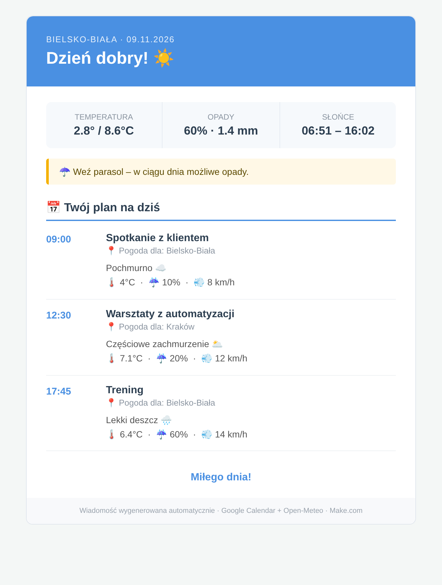
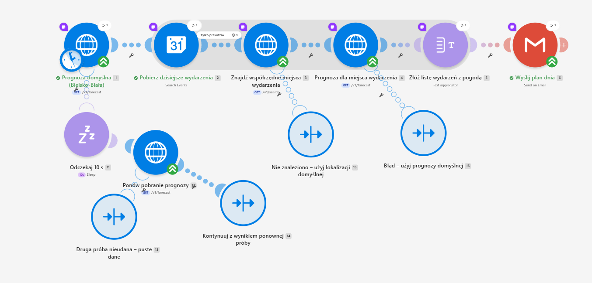
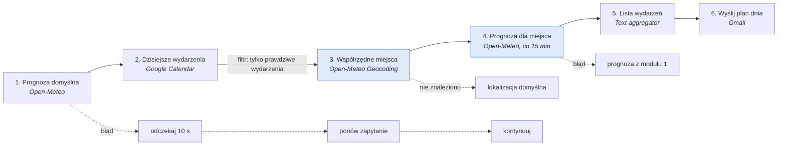

# Poranny plan dnia z pogodą dla miejsca wydarzenia

Scenariusz w [Make](https://www.make.com), który codziennie rano wysyła maila z wydarzeniami z Google Calendar i prognozą pogody dopasowaną do **godziny i miejsca każdego wydarzenia**, z dokładnością do 15 minut.

`Make` · `Google Calendar` · `Open-Meteo API` · `Gmail` · `HTTP / REST` · `obsługa błędów`

  
   Mail wygenerowany z szablonu scenariusza (przykładowe dane)

---

## Problem

Pierwotnie rozwiązanie powstało z myślą o instruktorach sportów outdoorowych, dla których precyzyjna prognoza w miejscu prowadzenia zajęć to podstawa planowania. W ich przypadku wiatr czy opady o konkretnej porze decydują o tym, czy zajęcia się odbędą.

## Rozwiązanie

Scenariusz w tym repozytorium to jego uniwersalna wersja, gotowa do podłączenia do własnego kalendarza Google. Codziennie o stałej porze wysyła jeden mail, który dla każdego wydarzenia zaplanowanego w Google Calendar pokazuje prognozę dokładnie na jego godzinę i miejsce. Całość uzupełnia szybkie podsumowanie dnia oraz praktyczna wskazówka na start (np. „weź parasol” lub „ubierz się ciepło”).

  

## Jak działa

Moduły 3 i 4 (niebieskie) uruchamiają się raz dla każdego wydarzenia, pozostałe raz na całe uruchomienie.

| # | Moduł | Co robi |
|---|---|---|
| 1 | Prognoza domyślna | Pobiera prognozę dla lokalizacji domyślnej: podsumowanie dnia w mailu i zapas na wypadek błędów. |
| 2 | Dzisiejsze wydarzenia | Pobiera wydarzenia z bieżącego dnia (strefa `Europe/Warsaw`). |
| 3 | Współrzędne miejsca | Wyciąga miejscowość z pola „Lokalizacja” i zamienia ją na współrzędne. |
| 4 | Prognoza dla miejsca | Pobiera prognozę 15-minutową dla współrzędnych wydarzenia. |
| 5 | Lista wydarzeń | Składa wiersze HTML: godzina, tytuł z linkiem, miejsce, opis pogody, temperatura, opady, wiatr. |
| 6 | Wyślij plan dnia | Wysyła mail HTML z podsumowaniem dnia, wskazówką i listą wydarzeń. |

## Najważniejsze decyzje projektowe

### Prognoza co 15 minut, nie „na dziś”

Open-Meteo zwraca temperaturę, kod pogody i wiatr w odstępach 15-minutowych. Szansę opadów API podaje tylko co godzinę, więc ta jedna wartość jest godzinowa.

### Miasto wyciągane z pełnego adresu

Wyszukiwarka współrzędnych szuka po nazwie miejscowości, a w kalendarzu bywa wpisany pełny adres. Wyrażenie w module 3 odcina kraj, kod pocztowy i ulicę:

| Lokalizacja w kalendarzu | Wyszukiwane miasto |
|---|---|
| `ul. Długa 5, 31-147 Kraków, Polska` | Kraków |
| `Rynek 1, 43-300 Bielsko-Biała` | Bielsko-Biała |
| `Spodek, Katowice` | Katowice |
| puste pole albo link do spotkania online | lokalizacja domyślna |

### Mail wychodzi zawsze

| Sytuacja | Zachowanie |
|---|---|
| Prognoza domyślna nie odpowiada | Odczekaj 10 s i ponów. Gdy znowu błąd, mail informuje, że prognoza jest chwilowo niedostępna. |
| Nie znaleziono miejscowości | Wydarzenie dostaje pogodę dla lokalizacji domyślnej. |
| Prognoza dla miejsca nie odpowiada | Wydarzenie dostaje prognozę z modułu 1 z dopiskiem „prognoza zastępcza”. |
| Wydarzenie całodniowe | Etykieta „Cały dzień”, zakres temperatur oraz maksymalna szansa opadów i siła wiatru z całego dnia. |
| Pusty kalendarz | Komunikat „masz wolny dzień”, podsumowanie pogody zostaje. |

Opis pogody z kodu WMO powstaje funkcją `switch()` w agregatorze, bez osobnego modułu Switcher, który uruchamiałby się (i kosztował) raz na każde wydarzenie.

## Testowanie

- Sprawdziłam parsowanie różnych formatów adresów: pełny adres z kodem pocztowym, samo miasto, brak lokalizacji.
- Przetestowałam przypadki brzegowe w kalendarzu: pusty dzień oraz wydarzenia całodniowe.
- Zasymulowałam błędy zapytań HTTP, żeby upewnić się, że ścieżki zapasowe (`Sleep` + `Resume`) działają i mail zawsze wychodzi.

## Uruchomienie u siebie

**Potrzebne:** konto Make (wystarczy darmowe), konto Google z Kalendarzem i Gmailem. Open-Meteo nie wymaga klucza API.

1. W Make utwórz nowy scenariusz.
2. Na dole kanwy otwórz menu **⋯** → **Import Blueprint** i wybierz plik [`blueprint/poranny-plan-dnia.blueprint.json`](blueprint/poranny-plan-dnia.blueprint.json).
3. W module **2** wybierz połączenie z Google Calendar, a w module **6** połączenie z Gmailem.
4. W module **6** wpisz swój adres w polu odbiorcy (domyślnie `twoj.email@example.com`).
5. Ustaw harmonogram: **Every day**, np. 6:30.
6. Kliknij **Run once** i sprawdź skrzynkę.

### Zmiana lokalizacji domyślnej

Domyślnie jest to Bielsko-Biała (49.8225, 19.0469). Aby ją zmienić, podmień:

| Moduł | Co zmienić |
|---|---|
| 1 | `latitude` i `longitude` w Query String |
| 3 | domyślną nazwę miasta na końcu wyrażenia w parametrze `name` |
| 4 | zapasowe współrzędne w `latitude` i `longitude` |
| 5 | nazwę miasta w podpisie „Pogoda dla” |
| 6 | nazwę miasta w nagłówku maila |

## Ograniczenia

- Lokalizacja jest rozpoznawana po nazwie miejscowości. Nazwa obiektu bez miasta, np. „Galeria Sfera”, trafia do lokalizacji domyślnej.
- Szansa opadów przy wydarzeniu pochodzi z pełnej godziny.
- Wszystkie godziny są liczone w strefie `Europe/Warsaw`.

